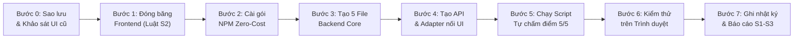
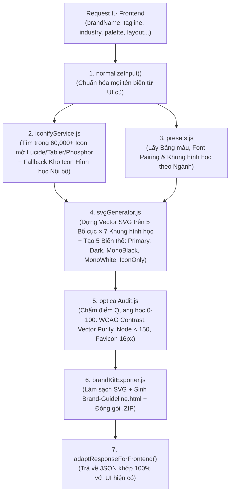

# 📘 MASTER HANDOVER SPEC: BACKEND HỆ THỐNG SÁNG TẠO LOGO DOANH NGHIỆP
> **Loại tài liệu:** Cẩm nang Cầm tay Chỉ việc Độc lập (Zero-Context, Step-by-Step Execution Playbook)  
> **Phiên bản:** `v2.0-foolproof` · **Ngày cập nhật:** `2026-11-07`  
> **Đối tượng thực thi:** Bất kỳ AI Agent nào (kể cả model nhỏ/nhanh, không có ngữ cảnh trước đó) tiếp nhận một dự án **đã có sẵn giao diện Web (Frontend)** và cần **xây dựng + đấu nối hoàn chỉnh phần Backend tạo Logo**.  
> **Nguyên tắc thiết kế tài liệu này:** **Không cần suy đoán (Zero Guessing).** Mọi công thức toán học SVG, bảng màu, System Prompt, code của cả 5 module Backend, lớp chuyển đổi (Adapter) và script tự chấm điểm đều được viết đầy đủ 100% bên dưới. Chỉ cần làm đúng từng bước từ **Bước 0 → Bước 7**.

---

## 🧭 BẢN ĐỒ THỰC THI NHANH (LÀM ĐÚNG THỨ TỰ 8 BƯỚC — KHÔNG BỎ BƯỚC)



| Bước | Việc phải làm | Đọc mục nào trong file này | Điều kiện hoàn thành ("Done When") |
| :--- | :--- | :--- | :--- |
| **Bước 0** | Tạo bản sao lưu (Snapshot) & tìm nơi Frontend đang gọi tạo logo | **Mục 1 & Mục 2** | Có thư mục `archive/pre-backend-snapshot/` + biết chính xác file Frontend nào gọi hàm tạo logo. |
| **Bước 1** | Ghi danh sách file Frontend vào diện "Đóng băng — Không sửa" | **Mục 1.2** | Cam kết không sửa CSS, không xóa component, không đổi cấu trúc trang Web hiện có. |
| **Bước 2** | Cài đặt các thư viện mở (`svgo`, `jszip`, `@resvg/resvg-js`) | **Mục 3** | Lệnh cài chạy thành công (hoặc dùng bản Pure-JS tích hợp sẵn ở Mục 5 nếu môi trường chặn cài đặt). |
| **Bước 3** | Copy nguyên văn 5 file Core Engine vào thư mục Backend | **Mục 5 (File 1 → File 5)** | Cả 5 file (`presets.js`, `opticalAudit.js`, `iconifyService.js`, `svgGenerator.js`, `brandKitExporter.js`) tồn tại và không có lỗi cú pháp. |
| **Bước 4** | Tạo API Route và nối vào Frontend qua hàm `adaptToFrontend()` | **Mục 6 (File 6 & Adapter)** | Nút bấm trên giao diện Web gọi được Backend và nhận về đúng định dạng biến mà giao diện đang chờ. |
| **Bước 5** | Chạy script tự chấm điểm độc lập `verify_logo_backend.js` | **Mục 7** | Terminal in ra dòng chữ: `ALL 5 POPPER GATES PASSED (5/5)`. |
| **Bước 6** | Mở trang Web thật, nhập thử tên thương hiệu, bấm tạo & tải file | **Mục 8** | Trang Web hiển thị logo SVG sắc nét, `0` lỗi Console, tải được file `.svg` / `.png` / `.zip`. |
| **Bước 7** | Xuất báo cáo cuối cùng theo mẫu chuẩn | **Mục 9** | Báo cáo có bảng Kiểm quy tắc thường trực (S1–S3) và kết thúc bằng mục `👉 Bước tiếp theo`. |

---

## 1. QUY TẮC THƯỜNG TRỰC & 8 ĐIỀU CẤM KỴ (ĐỌC KỸ TRƯỚC KHI CODE)

### 1.1. Ba Quy tắc Thường trực của Chủ dự án (Standing Rules S1–S3 — BẮT BUỘC)
> - **S1.** *"Always check hallucination status before answering. Always apply my Karpathy epistemics skill and /project-management skill when working, no hallucination, no lazy, keep the current skills design system."*
> - **S2.** *"Only fix the item having issue. Do not change any app functions that I already approved."*
> - **S3.** *"Always crosscheck if the change affect the functions indirectly to ensure the system can operate smoothly."*

### 1.2. Bảng 8 Điều CẤM KỴ & PHẢI LÀM (Dành cho mọi Agent)
| ❌ TUYỆT ĐỐI KHÔNG LÀM (CẤM) | ✅ BẮT BUỘC PHẢI LÀM (ĐÚNG) |
| :--- | :--- |
| **1. Không đập đi xây lại giao diện Web (Frontend) đã có sẵn.** | Giữ nguyên 100% bố cục, màu sắc, component và luồng màn hình của Web hiện tại (Quy tắc S2). |
| **2. Không bắt Frontend phải đổi tên biến/state hiện có.** | Viết hàm chuyển đổi (`Adapter`) ở Backend/Service để trả về đúng tên trường (field names) mà Frontend đang đọc (Quy tắc S3). |
| **3. Không nhúng ảnh `<image href="data:image/png...">` vào trong thẻ `<svg>` rồi gọi đó là logo Vector.** | Logo SVG bắt buộc phải cấu tạo 100% từ các thẻ hình học thật: `<path>`, `<circle>`, `<rect>`, `<polygon>`, `<g>`, `<text>`. |
| **4. Không dùng chữ `...` hay `// TODO: implement later` khi copy code.** | Copy đầy đủ 100% mã nguồn hoàn chỉnh trong **Mục 5 & Mục 6** của tài liệu này. |
| **5. Không cài đặt thư viện trả phí hoặc giấy phép GPL lây nhiễm (như `potrace` gốc).** | Chỉ dùng các thư viện giấy phép **MIT / Apache-2.0 / ISC** (`svgo`, `jszip`, `@resvg/resvg-js`, `vtracer`, `lucide`, `tabler`). |
| **6. Không để hệ thống bị treo (crash) nếu mất mạng hoặc hết lượt gọi AI.** | Luôn dùng cơ chế **Hybrid 2 Luồng**: Luồng 1 (Toán học hình học + Kho icon nội bộ) luôn chạy thành công trong `< 100ms` kể cả khi không có mạng hay API key. |
| **7. Không xuất file SVG bị thiếu thuộc tính `viewBox`.** | Mọi thẻ `<svg>` xuất ra bắt buộc phải có `xmlns="http://www.w3.org/2000/svg"` và `viewBox="0 0 600 240"` (hoặc `500 380` / `200 200`). |
| **8. Không bao giờ báo cáo "Đã xong" nếu chưa chạy lệnh kiểm thử.** | Phải chạy script kiểm thử ở **Mục 7** đạt `5/5` và ghi rõ con số vào báo cáo. |

---

## 2. BƯỚC 0 & BƯỚC 1: SAO LƯU VÀ KHẢO SÁT FRONTEND HIỆN CÓ

Trước khi viết bất kỳ dòng code nào, hãy mở Terminal tại thư mục dự án Web và chạy đúng 3 lệnh sau:

```bash
# Lệnh 1: Tạo bản sao lưu (Rollback Snapshot) để có thể khôi phục trong 5 giây nếu cần
mkdir -p archive/pre-backend-snapshot
cp -R package.json src public pages app components archive/pre-backend-snapshot/ 2>/dev/null || true

# Lệnh 2: Kiểm tra dự án đang dùng framework gì (Vite, Next.js, Express, hay HTML thuần)
cat package.json 2>/dev/null || ls -la

# Lệnh 3: Tìm chính xác file Frontend nào đang chứa nút "Generate" / "Tạo Logo" / "Download"
grep -rnE "generate|logo|download|export|fetch\(|axios" src/ app/ pages/ components/ 2>/dev/null | head -n 40
```

### Cách xác định điểm đấu nối (Wiring Point) trong 1 phút:
Sau khi chạy Lệnh 3, hãy mở file Frontend xử lý sự kiện bấm nút **"Tạo Logo"** và ghi lại 2 thông tin:
1. **Đầu vào (Input) từ Form của UI:** Giao diện đang gom những biến nào? (Ví dụ: `{ name, slogan, industry, color, style }` hay `{ brandName, tagline, category, palette }`).
2. **Đầu ra (Output) mà UI dùng để hiển thị (`map`):** Giao diện đang lặp qua mảng nào để vẽ danh sách logo? (Ví dụ: `results.map(item => item.svg)` hay `logos.map(l => l.svgCode)`).
> 💡 **Ghi nhớ:** Bạn sẽ điền tên các biến này vào hàm `adaptResponseForExistingUI()` ở **Mục 6.2** để giao diện hiện tại hoạt động ngay lập tức mà không cần sửa code giao diện!

---

## 3. BƯỚC 2: BỘ CÔNG CỤ ĐÃ TUYỂN CHỌN & LỆNH CÀI ĐẶT (ZERO-COST GOLDEN STACK)

Hệ thống đã được nghiên cứu và chấm điểm từ **Top 10 Agent Skills, Top 10 MCPs/Tools và Top 10 Libraries** theo 6 tiêu chí (*Popularity, Quality, Relevance, Safe, Free, Web-App Online Fit* — chi tiết tại `docs/03-analysis/DISCOVERY.md`).

### 3.1. Tinh hoa từ Top Skills & MCPs đã được nhúng sẵn vào Code ở Mục 5
Bạn **KHÔNG CẦN** phải đi tìm hay đọc lại các repo bên ngoài vì toàn bộ thuật toán tốt nhất của chúng đã được biên dịch sẵn thành code JavaScript trong **Mục 5**:
- **`kaankiziltug/logo-design-skill` (~6,000 ⭐):** Quy tắc lưới hình học, tỷ lệ cân bằng quang học, System Prompt sinh SVG và bộ chấm điểm độ rõ nét ở kích thước Favicon `16x16px` → Đã code sẵn trong `svgGenerator.js` và `opticalAudit.js`.
- **`nextlevelbuilder/ui-ux-pro-max-skill` (~140,000 ⭐) + `theme-factory`:** Bảng ánh xạ Ngành nghề → Bảng màu HEX + Cặp Font chữ + Khung hình học (bao gồm bộ nhận diện chuẩn **Gobita AI**) → Đã code sẵn trong `presets.js`.
- **Iconify Public API (`awssat/mcp-universal-icons` — 60,000+ icon MIT mở từ `lucide`, `tabler`, `phosphor`):** Tự động tìm kiếm biểu tượng theo từ khóa ngành nghề trong `<100ms` kèm kho icon dự phòng offline → Đã code sẵn trong `iconifyService.js`.
- **`mcpware/logoloom` + `fatihaydost/brand-identity-skill` + `nolangz/pixel2motion`:** Tự động sinh 5 biến thể (`Primary`, `Dark`, `Mono-Black`, `Mono-White`, `Icon-Only`), hiệu ứng động SVG (`animated`) và trang `Brand-Guideline.html` → Đã code sẵn trong `brandKitExporter.js`.

### 3.2. Lệnh cài đặt thư viện phụ trợ (Tuỳ chọn — Code ở Mục 5 chạy được ngay cả khi không cài thêm gì!)
Nếu dự án có `package.json` và có kết nối mạng, bạn có thể cài thêm 3 gói MIT/Apache-2.0 sau để nén tối đa SVG/ZIP và xuất PNG phía server:
```bash
npm install svgo jszip @resvg/resvg-js
```
> **Đặc biệt an toàn:** Toàn bộ code ở **Mục 5** được thiết kế theo cơ chế **Zero-Dependency Resilient** — nghĩa là nếu môi trường không cho phép chạy `npm install`, cả 5 file trong Mục 5 **vẫn tự chạy 100% bằng Node.js / Browser JS thuần** (có sẵn bộ nén SVG và bộ đóng gói `.ZIP` chuẩn二进制 CRC32 thuần JS bên trong)!

---

## 4. KIẾN TRÚC KỸ THUẬT CỦA 5 MODULE BACKEND



---

## 5. BƯỚC 3: MÃ NGUỒN ĐẦY ĐỦ CỦA 5 MODULE BACKEND (COPY & PASTE 100%)

> **Hướng dẫn cho Agent:** Hãy tạo thư mục `src/logo-backend/` (hoặc `lib/logo-backend/` tùy cấu trúc dự án) và tạo lần lượt **5 file dưới đây** với nội dung giữ nguyên 100%. Code hỗ trợ cả `CommonJS (require)` lẫn `ES Modules (import)` và chạy được cả trên **Node.js Backend** lẫn **Browser Client-Side**!

---

### 📄 FILE 1/5: `src/logo-backend/presets.js`
*(Chứa quy chuẩn thương hiệu Gobita AI, 6 ngành nghề, 10 bảng màu chuyên nghiệp, 7 cặp font chữ và 12 biểu tượng hình học Vector `<path>` dự phòng)*

```javascript
/**
 * FILE 1: src/logo-backend/presets.js
 * Industry Presets, Gobita AI Official Brand Guidelines, Color Palettes,
 * Font Pairings & 12 Built-in Geometric Vector Icons (24x24 viewBox).
 */

const BRAND_PRESETS = {
  gobitaOfficial: {
    brandName: "GOBITA.AI",
    tagline: "Go Big, Take Action",
    palette: {
      primary: "#F97300",     // Cam AI (Innovation, friendliness)
      secondary: "#FAD45C",   // Vàng nhạt (Creativity, intuition)
      accentRed: "#D72638",   // Đỏ năng lượng (Attention, CTA)
      textDark: "#6B4C3B",    // Nâu đất (Trust, stability)
      background: "#FFFDF7",  // Trắng kem ấm
      darkBackground: "#18120E"
    },
    fonts: ["Montserrat", "Poppins", "Raleway"]
  },

  palettes: [
    { id: "gobita-official", name: "Gobita AI Official", primary: "#F97300", secondary: "#FAD45C", text: "#6B4C3B", bg: "#FFFDF7", darkBg: "#18120E" },
    { id: "gobita-energy", name: "Gobita Energy Red", primary: "#D72638", secondary: "#F97300", text: "#231815", bg: "#FAFAFA", darkBg: "#140D0E" },
    { id: "linear-indigo", name: "Linear Tech Indigo", primary: "#5E6AD2", secondary: "#38BDF8", text: "#0F172A", bg: "#F8FAFC", darkBg: "#090B10" },
    { id: "fintech-royal", name: "Fintech Royal Blue", primary: "#4F46E5", secondary: "#06B6D4", text: "#0A2540", bg: "#F8FAFC", darkBg: "#071324" },
    { id: "emerald-venture", name: "Emerald Growth", primary: "#059669", secondary: "#34D399", text: "#064E3B", bg: "#F6FEF9", darkBg: "#051B14" },
    { id: "sovereign-gold", name: "Atelier Luxury Gold", primary: "#C59B27", secondary: "#FAD45C", text: "#18181B", bg: "#FAF8F5", darkBg: "#0D0D0F" },
    { id: "solaris-amber", name: "Solaris Terracotta", primary: "#EA580C", secondary: "#FACC15", text: "#292524", bg: "#FFFBEB", darkBg: "#17120E" },
    { id: "oceanic-cyan", name: "Oceanic Global", primary: "#0284C7", secondary: "#2DD4BF", text: "#0C4A6E", bg: "#F5FBFF", darkBg: "#061A26" },
    { id: "cyber-magenta", name: "Cyber Creator Pulse", primary: "#DB2777", secondary: "#8B5CF6", text: "#1E1B4B", bg: "#FDF8FC", darkBg: "#11081F" },
    { id: "swiss-mono", name: "Swiss Minimalist", primary: "#171717", secondary: "#525252", text: "#111111", bg: "#FFFFFF", darkBg: "#0A0A0A" }
  ],

  fonts: [
    { id: "montserrat", name: "Montserrat", family: "'Montserrat', 'Helvetica Neue', sans-serif", weight: 800, tracking: "0.03em", taglineFont: "'Poppins', sans-serif" },
    { id: "poppins", name: "Poppins", family: "'Poppins', 'Segoe UI', sans-serif", weight: 700, tracking: "0.01em", taglineFont: "'Montserrat', sans-serif" },
    { id: "raleway", name: "Raleway", family: "'Raleway', 'Helvetica Neue', sans-serif", weight: 800, tracking: "0.05em", taglineFont: "'Montserrat', sans-serif" },
    { id: "outfit", name: "Outfit", family: "'Outfit', sans-serif", weight: 700, tracking: "0.02em", taglineFont: "'Outfit', sans-serif" },
    { id: "syne", name: "Syne", family: "'Syne', sans-serif", weight: 800, tracking: "0.04em", taglineFont: "'Plus Jakarta Sans', sans-serif" },
    { id: "playfair", name: "Playfair Display", family: "'Playfair Display', Georgia, serif", weight: 700, tracking: "0.02em", taglineFont: "'Montserrat', sans-serif" },
    { id: "jetbrains", name: "JetBrains Mono", family: "'JetBrains Mono', monospace", weight: 700, tracking: "-0.01em", taglineFont: "'JetBrains Mono', monospace" }
  ],

  industries: {
    "ai-tech": {
      name: "AI, SaaS & Công nghệ",
      keywords: ["cpu", "brain", "network", "sparkles", "hexagon", "rocket", "code", "bot"],
      defaultPaletteIds: ["gobita-official", "linear-indigo", "oceanic-cyan"],
      defaultFonts: ["montserrat", "outfit", "jetbrains"],
      defaultContainers: ["hexagon", "squircle", "octagon", "circle"]
    },
    "finance-corp": {
      name: "Tài chính, Đầu tư & B2B",
      keywords: ["shield", "trending-up", "compass", "diamond", "crown", "globe", "landmark"],
      defaultPaletteIds: ["fintech-royal", "emerald-venture", "sovereign-gold"],
      defaultFonts: ["raleway", "montserrat", "playfair"],
      defaultContainers: ["shield", "diamond", "hexagon", "squircle"]
    },
    "education-coaching": {
      name: "Giáo dục, Đào tạo & Coaching",
      keywords: ["book-open", "lightbulb", "target", "award", "brain", "graduation-cap", "rocket"],
      defaultPaletteIds: ["gobita-official", "gobita-energy", "oceanic-cyan"],
      defaultFonts: ["poppins", "montserrat", "raleway"],
      defaultContainers: ["hexagon", "squircle", "circle", "shield"]
    },
    "commerce-retail": {
      name: "Bán lẻ, Điện máy & E-Commerce",
      keywords: ["zap", "shopping-bag", "store", "star", "layers", "home", "flame"],
      defaultPaletteIds: ["gobita-energy", "solaris-amber", "gobita-official"],
      defaultFonts: ["montserrat", "poppins", "outfit"],
      defaultContainers: ["squircle", "circle", "hexagon", "diamond"]
    },
    "food-lifestyle": {
      name: "F&B, Sinh thái & Sức khỏe",
      keywords: ["leaf", "coffee", "flame", "sun", "heart", "sparkles", "droplet"],
      defaultPaletteIds: ["emerald-venture", "solaris-amber", "gobita-official"],
      defaultFonts: ["poppins", "outfit", "playfair"],
      defaultContainers: ["circle", "squircle", "hexagon", "shield"]
    },
    "creative-media": {
      name: "Agency, Thiết kế & Sáng tạo",
      keywords: ["aperture", "feather", "sparkles", "layers", "wand", "hexagon", "compass"],
      defaultPaletteIds: ["sovereign-gold", "cyber-magenta", "swiss-mono"],
      defaultFonts: ["syne", "raleway", "montserrat"],
      defaultContainers: ["diamond", "hexagon", "circle", "none"]
    }
  },

  // 12 Built-in Pure Vector Icons (24x24 viewBox) — 100% Offline Fallback
  builtInIcons: [
    {
      id: "builtin:neural-hex",
      name: "Neural Hexagon (Gobita Core)",
      keywords: ["ai", "tech", "hexagon", "network", "cpu", "gobita", "node"],
      paths: [
        "M12 2L20.66 7V17L12 22L3.34 17V7L12 2Z",
        "M12 8L16 10.5V15.5L12 18L8 15.5V10.5L12 8Z",
        "M12 2V8M20.66 7L16 10.5M20.66 17L16 15.5M12 22V18M3.34 17L8 15.5M3.34 7L8 10.5"
      ],
      circles: [{ cx: 12, cy: 13, r: 1.7 }]
    },
    {
      id: "builtin:brain-intelligence",
      name: "Brain Intelligence",
      keywords: ["brain", "ai", "mind", "smart", "education", "coaching", "think"],
      paths: [
        "M9.5 3A4.5 4.5 0 0 0 5 7.5c0 .88.25 1.7.69 2.4A4.5 4.5 0 0 0 4 13.5 4.5 4.5 0 0 0 8.5 18H9v3h6v-3h.5a4.5 4.5 0 0 0 4.5-4.5c0-1.47-.7-2.77-1.79-3.6.44-.7.69-1.52.69-2.4A4.5 4.5 0 0 0 14.5 3c-1.15 0-2.2.43-3 1.14A4.48 4.48 0 0 0 9.5 3Z",
        "M12 4.2V18",
        "M8.5 9.5h2v3h-2",
        "M15.5 9.5h-2v3h2"
      ],
      circles: [{ cx: 8.5, cy: 9.5, r: 1 }, { cx: 15.5, cy: 9.5, r: 1 }]
    },
    {
      id: "builtin:rocket-action",
      name: "Rocket Take Action",
      keywords: ["rocket", "action", "startup", "growth", "speed", "launch", "gobita"],
      paths: [
        "M4.5 16.5c-1.5 1.26-2 5-2 5s3.74-.5 5-2c.71-.84.7-2.13-.09-2.91a2.18 2.18 0 0 0-2.91-.09Z",
        "M12 15l-3-3a22 22 0 0 1 2-3.95A12.88 12.88 0 0 1 22 2c0 2.72-.78 7.5-6 11a22.35 22.35 0 0 1-4 2Z",
        "M9 12H4s.55-3.03 2-4c1.62-1.08 5 0 5 0",
        "M12 15v5s3.03-.55 4-2c1.08-1.62 0-5 0-5"
      ],
      circles: [{ cx: 15, cy: 9, r: 1.5 }]
    },
    {
      id: "builtin:sparkle-core",
      name: "AI Sparkle Star",
      keywords: ["sparkles", "star", "ai", "magic", "creative", "gen", "future"],
      paths: [
        "M12 2L14.8 9.2L22 12L14.8 14.8L12 22L9.2 14.8L2 12L9.2 9.2L12 2Z",
        "M19 3L19.7 5.3L22 6L19.7 6.7L19 9L18.3 6.7L16 6L18.3 5.3L19 3Z"
      ],
      circles: []
    },
    {
      id: "builtin:shield-trust",
      name: "Executive Shield",
      keywords: ["shield", "finance", "security", "trust", "safe", "bank", "corp"],
      paths: [
        "M12 22s8-4 8-10V5l-8-3-8 3v7c0 6 8 10 8 10z",
        "M9 12l2 2 4-4"
      ],
      circles: []
    },
    {
      id: "builtin:trending-growth",
      name: "Growth Arrow Peak",
      keywords: ["trending-up", "arrow", "growth", "finance", "sales", "gtm", "chart"],
      paths: [
        "M22 7L13.5 15.5L8.5 10.5L2 17",
        "M16 7H22V13"
      ],
      circles: []
    },
    {
      id: "builtin:bolt-energy",
      name: "Hyper Lightning Bolt",
      keywords: ["zap", "bolt", "energy", "power", "commerce", "retail", "fast"],
      paths: [
        "M13 2L3 14h9l-1 8 10-12h-9l1-8z"
      ],
      circles: []
    },
    {
      id: "builtin:book-academy",
      name: "Open Book Academy",
      keywords: ["book-open", "education", "study", "academy", "school", "learn"],
      paths: [
        "M2 3h6a4 4 0 0 1 4 4v14a3 3 0 0 0-3-3H2z",
        "M22 3h-6a4 4 0 0 0-4 4v14a3 3 0 0 1 3-3h7z"
      ],
      circles: []
    },
    {
      id: "builtin:target-mastery",
      name: "Target Bullseye",
      keywords: ["target", "goal", "focus", "kpi", "strategy", "compass"],
      paths: [
        "M22 2L12 12",
        "M16 2h6v6"
      ],
      circles: [{ cx: 12, cy: 12, r: 9 }, { cx: 12, cy: 12, r: 5 }, { cx: 12, cy: 12, r: 1.8 }]
    },
    {
      id: "builtin:leaf-organic",
      name: "Botanical Eco Leaf",
      keywords: ["leaf", "eco", "nature", "food", "organic", "health", "green"],
      paths: [
        "M11 20A7 7 0 0 1 9.8 6.1C15.5 5 17 4.48 19 2c1 2 2 4.18 2 8 0 5.5-4.78 10-10 10Z",
        "M2 21c0-3 1.85-5.36 5.08-6C9.5 14.52 12 13 13 12"
      ],
      circles: []
    },
    {
      id: "builtin:diamond-luxury",
      name: "Diamond Precision",
      keywords: ["diamond", "gem", "luxury", "crown", "value", "prestige"],
      paths: [
        "M6 3h12l4 6-10 12L2 9z",
        "M11 3L8 9l4 12 4-12-3-6",
        "M2 9h20"
      ],
      circles: []
    },
    {
      id: "builtin:layers-platform",
      name: "Isometric Platform Layers",
      keywords: ["layers", "platform", "system", "stack", "cloud", "store"],
      paths: [
        "M12 2L2 7l10 5 10-5-10-5z",
        "M2 17l10 5 10-5",
        "M2 12l10 5 10-5"
      ],
      circles: []
    }
  ]
};

if (typeof module !== "undefined" && module.exports) {
  module.exports = { BRAND_PRESETS };
}
```

---

### 📄 FILE 2/5: `src/logo-backend/opticalAudit.js`
*(Bộ chấm điểm Quang học tự động `0–100` theo chuẩn `kaankiziltug/logo-design-skill`: Tính độ tương phản WCAG 2.1, kiểm tra độ tinh khiết Vector, đếm số node `< 150` và kiểm tra hiển thị Favicon `16x16px`)*

```javascript
/**
 * FILE 2: src/logo-backend/opticalAudit.js
 * Automated Optical QA & 16px Favicon Legibility Auditor
 */

function hexToLuminance(hex) {
  const clean = String(hex || "#000000").replace("#", "").trim();
  const fullHex = clean.length === 3
    ? clean.split("").map((c) => c + c).join("")
    : clean.padEnd(6, "0").slice(0, 6);
  const r = parseInt(fullHex.substring(0, 2), 16) / 255;
  const g = parseInt(fullHex.substring(2, 4), 16) / 255;
  const b = parseInt(fullHex.substring(4, 6), 16) / 255;
  const [R, G, B] = [r, g, b].map((v) =>
    v <= 0.03928 ? v / 12.92 : Math.pow((v + 0.055) / 1.055, 2.4)
  );
  return 0.2126 * R + 0.7152 * G + 0.0722 * B;
}

function getContrastRatio(hex1, hex2) {
  const l1 = hexToLuminance(hex1);
  const l2 = hexToLuminance(hex2);
  const brightest = Math.max(l1, l2);
  const darkest = Math.min(l1, l2);
  return Number(((brightest + 0.05) / (darkest + 0.05)).toFixed(2));
}

function auditLogoSVG(svgString, palette = {}) {
  const svg = String(svgString || "");
  const hasViewBox = /viewBox=["'][^"']+["']/i.test(svg);
  const hasRasterImage = /<image\b/i.test(svg);
  const hasVectorPrimitives = /<(path|circle|rect|polygon|polyline|ellipse|g)\b/i.test(svg);
  const isPureVector = hasViewBox && !hasRasterImage && hasVectorPrimitives;

  const nodeMatches = svg.match(/<(path|circle|rect|polygon|line|polyline|ellipse)\b/gi) || [];
  const nodeCount = nodeMatches.length;
  const byteSize = typeof Buffer !== "undefined"
    ? Buffer.byteLength(svg, "utf8")
    : new Blob([svg]).size;

  const textHex = palette.text || palette.textDark || "#6B4C3B";
  const bgHex = palette.bg || palette.background || "#FFFDF7";
  const primaryHex = palette.primary || "#F97300";

  const textContrast = getContrastRatio(textHex, bgHex);
  const primaryContrast = getContrastRatio(primaryHex, bgHex);

  const favicon16pxPass =
    isPureVector &&
    nodeCount >= 1 &&
    nodeCount <= 150 &&
    byteSize < 15360 &&
    primaryContrast >= 1.8;

  let score = 100;
  if (!isPureVector) score -= 50;
  if (nodeCount > 150) score -= 20;
  if (byteSize > 15360) score -= 15;
  if (textContrast < 4.5) score -= 10;
  if (primaryContrast < 2.0) score -= 10;

  const finalScore = Math.max(0, score);
  return {
    overallScore: finalScore,
    grade: finalScore >= 90 ? "A+" : finalScore >= 80 ? "A" : finalScore >= 70 ? "B" : "C",
    contrastRatio: textContrast,
    primaryContrastRatio: primaryContrast,
    wcagLevel: textContrast >= 7 ? "AAA" : textContrast >= 4.5 ? "AA" : "AA-Large",
    isPureVector,
    hasViewBox,
    nodeCount,
    byteSize,
    favicon16pxPass,
    monochromeReady: isPureVector && nodeCount <= 150
  };
}

if (typeof module !== "undefined" && module.exports) {
  module.exports = { hexToLuminance, getContrastRatio, auditLogoSVG };
}
```

---

### 📄 FILE 3/5: `src/logo-backend/iconifyService.js`
*(Kết nối trực tiếp kho 60,000+ biểu tượng vector mở của `api.iconify.design` từ các bộ `lucide`, `tabler`, `ph` với cơ chế tự động chuyển sang Kho Icon Nội bộ trong `presets.js` nếu mất mạng hoặc quá 2.5 giây)*

```javascript
/**
 * FILE 3: src/logo-backend/iconifyService.js
 * Searches 60,000+ commercial-free MIT/ISC SVG icons via Iconify API
 * with instant offline fallback to BRAND_PRESETS.builtInIcons.
 */

const { BRAND_PRESETS } = require("./presets");

function renderBuiltInIconInnerSvg(iconObj) {
  const pathTags = (iconObj.paths || []).map(
    (d) => `<path d="${d}" fill="none" stroke="currentColor" stroke-width="2" stroke-linecap="round" stroke-linejoin="round"/>`
  );
  const circleTags = (iconObj.circles || []).map(
    (c) => `<circle cx="${c.cx}" cy="${c.cy}" r="${c.r}" fill="currentColor"/>`
  );
  return [...pathTags, ...circleTags].join("");
}

function getFallbackIconsByKeywords(keywords = [], limit = 6) {
  const kwList = (Array.isArray(keywords) ? keywords : [keywords])
    .map((k) => String(k || "").toLowerCase().trim())
    .filter(Boolean);

  const scored = BRAND_PRESETS.builtInIcons.map((icon) => {
    let matchScore = 0;
    for (const kw of kwList) {
      if (icon.keywords.some((ik) => ik.includes(kw) || kw.includes(ik))) {
        matchScore += 2;
      }
      if (icon.name.toLowerCase().includes(kw)) {
        matchScore += 1;
      }
    }
    return { icon, matchScore };
  });

  scored.sort((a, b) => b.matchScore - a.matchScore);
  return scored.slice(0, limit).map(({ icon }) => ({
    id: icon.id,
    name: icon.name,
    source: "builtin-geometric",
    innerSvg: renderBuiltInIconInnerSvg(icon)
  }));
}

async function searchVectorIcons(queryOrKeywords = ["ai", "hexagon"], limit = 6, options = {}) {
  const keywords = Array.isArray(queryOrKeywords) ? queryOrKeywords : [queryOrKeywords];
  const fallbackList = getFallbackIconsByKeywords(keywords, limit);

  if (options.offlineOnly || typeof fetch !== "function") {
    return fallbackList;
  }

  const queryStr = keywords.slice(0, 2).join(" ").trim() || "hexagon";
  const controller = new AbortController();
  const timer = setTimeout(() => controller.abort(), options.timeoutMs || 2200);

  try {
    const searchUrl = `https://api.iconify.design/search?query=${encodeURIComponent(queryStr)}&prefixes=lucide,tabler,ph&limit=${limit}`;
    const res = await fetch(searchUrl, { signal: controller.signal });
    if (!res.ok) throw new Error(`HTTP ${res.status}`);
    const data = await res.json();
    const iconNames = (data && data.icons) ? data.icons.slice(0, limit) : [];
    if (iconNames.length === 0) return fallbackList;

    const fetched = await Promise.all(
      iconNames.map(async (fullIconName) => {
        const [prefix, name] = fullIconName.split(":");
        const svgRes = await fetch(`https://api.iconify.design/${prefix}/${name}.svg?height=24`, {
          signal: controller.signal
        });
        if (!svgRes.ok) return null;
        const svgText = await svgRes.text();
        const match = svgText.match(/<svg[^>]*>([\s\S]*?)<\/svg>/i);
        if (!match || !match[1]) return null;
        return {
          id: fullIconName,
          name: name.replace(/-/g, " "),
          source: "iconify-api",
          innerSvg: match[1].trim()
        };
      })
    );

    clearTimeout(timer);
    const valid = fetched.filter(Boolean);
    return valid.length > 0 ? [...valid, ...fallbackList].slice(0, limit) : fallbackList;
  } catch (_err) {
    clearTimeout(timer);
    return fallbackList;
  }
}

if (typeof module !== "undefined" && module.exports) {
  module.exports = { searchVectorIcons, getFallbackIconsByKeywords, renderBuiltInIconInnerSvg };
}
```

---

### 📄 FILE 4/5: `src/logo-backend/svgGenerator.js`
*(Trái tim Toán học Vector: Dựng khung đa giác chuẩn Lục giác Gobita / Squircle / Khiên / Kim cương, ghép biểu tượng, tách màu tên thương hiệu thông minh như `GOBITA` + `.AI`, tạo 5 bố cục và tự động xuất 5 biến thể màu cho mỗi mẫu logo)*

```javascript
/**
 * FILE 4: src/logo-backend/svgGenerator.js
 * Pure Mathematical SVG Logo Synthesis Engine
 * Supports 5 Layouts x 7 Geometric Containers x 5 Color Modes + Animated SVG
 */

const { BRAND_PRESETS } = require("./presets");
const { auditLogoSVG } = require("./opticalAudit");

function escapeXml(str) {
  return String(str || "")
    .replace(/&/g, "&amp;")
    .replace(/</g, "&lt;")
    .replace(/>/g, "&gt;")
    .replace(/"/g, "&quot;")
    .replace(/'/g, "&apos;");
}

/**
 * Tách tên thương hiệu thành 2 phần để phối màu nhấn (VD: "GOBITA.AI" -> ["GOBITA", ".AI"])
 */
function splitBrandNameParts(brandName) {
  const raw = String(brandName || "GOBITA.AI").trim();
  if (raw.includes(".")) {
    const idx = raw.lastIndexOf(".");
    return [raw.slice(0, idx), raw.slice(idx)];
  }
  const words = raw.split(/\s+/);
  if (words.length >= 2) {
    return [words.slice(0, -1).join(" ") + " ", words[words.length - 1]];
  }
  if (raw.length > 5) {
    return [raw.slice(0, -2), raw.slice(-2)];
  }
  return [raw, ""];
}

/**
 * Vẽ khung hình học (Container) trên hệ tọa độ chuẩn 120x120 (tâm tại 60, 60)
 */
function buildContainerShapeMarkup(containerType, styleType, primaryColor, secondaryColor, gradId) {
  const fillVal = styleType === "gradient"
    ? `url(#${gradId})`
    : styleType === "outline"
      ? "none"
      : primaryColor;
  const strokeVal = styleType === "outline" ? `url(#${gradId})` : secondaryColor;
  const strokeW = styleType === "outline" ? 5 : 2;

  switch (containerType) {
    case "hexagon":
      return `<polygon points="60,6 108,33 108,87 60,114 12,87 12,33" fill="${fillVal}" stroke="${strokeVal}" stroke-width="${strokeW}" stroke-linejoin="round"/>`;
    case "squircle":
      return `<rect x="10" y="10" width="100" height="100" rx="28" ry="28" fill="${fillVal}" stroke="${strokeVal}" stroke-width="${strokeW}"/>`;
    case "circle":
      return `<circle cx="60" cy="60" r="50" fill="${fillVal}" stroke="${strokeVal}" stroke-width="${strokeW}"/>`;
    case "diamond":
      return `<polygon points="60,6 114,60 60,114 6,60" fill="${fillVal}" stroke="${strokeVal}" stroke-width="${strokeW}" stroke-linejoin="round"/>`;
    case "shield":
      return `<path d="M60 8 L106 24 V58 C106 88 60 112 60 112 C60 112 14 88 14 58 V24 Z" fill="${fillVal}" stroke="${strokeVal}" stroke-width="${strokeW}" stroke-linejoin="round"/>`;
    case "octagon":
      return `<polygon points="39,8 81,8 112,39 112,81 81,112 39,112 8,81 8,39" fill="${fillVal}" stroke="${strokeVal}" stroke-width="${strokeW}" stroke-linejoin="round"/>`;
    case "none":
    default:
      return `<circle cx="60" cy="60" r="50" fill="none" stroke="${primaryColor}" stroke-width="2.5" stroke-dasharray="6 6" opacity="0.35"/>`;
  }
}

/**
 * Dựng khối Biểu tượng (Icon Box 120x120) đặt tại tọa độ (offsetX, offsetY) với tỷ lệ scale
 */
function buildIconMarkGroup({
  offsetX,
  offsetY,
  boxScale = 1,
  container = "hexagon",
  containerStyle = "gradient",
  iconInnerSvg = "",
  primaryColor = "#F97300",
  secondaryColor = "#FAD45C",
  iconForeground = "#FFFFFF",
  gradId = "grad_main"
}) {
  const effectiveIconColor = (container === "none" || containerStyle === "outline")
    ? primaryColor
    : iconForeground;
  const shapeMarkup = buildContainerShapeMarkup(container, containerStyle, primaryColor, secondaryColor, gradId);
  const recoloredInner = String(iconInnerSvg || "")
    .replace(/currentColor/g, effectiveIconColor)
    .replace(/stroke-width=["']2["']/g, 'stroke-width="2.2"');

  return `<g transform="translate(${offsetX}, ${offsetY}) scale(${boxScale})">
    ${shapeMarkup}
    <g transform="translate(26, 26) scale(2.8333)" style="color:${effectiveIconColor}">
      ${recoloredInner}
    </g>
  </g>`;
}

/**
 * Hàm chính: Sinh mã SVG chuẩn theo Cấu hình & Chế độ màu (colorMode: 'primary' | 'dark' | 'monoBlack' | 'monoWhite' | 'iconOnly')
 */
function generateSingleLogoSVG(config = {}, colorMode = "primary") {
  const brandName = config.brandName || "GOBITA.AI";
  const tagline = config.tagline !== undefined ? config.tagline : "Go Big, Take Action";
  const layout = colorMode === "iconOnly" ? "icon-only" : (config.layout || "horizontal");
  const container = config.container || "hexagon";
  const containerStyle = config.containerStyle || "gradient";
  const fontObj = BRAND_PRESETS.fonts.find((f) => f.id === config.fontId || f.name === config.fontFamily) || BRAND_PRESETS.fonts[0];
  const basePalette = config.palette || BRAND_PRESETS.palettes[0];

  // Xác định bảng màu theo từng chế độ xuất (Primary, Dark, Monochrome Black, Monochrome White)
  let primary = basePalette.primary || "#F97300";
  let secondary = basePalette.secondary || "#FAD45C";
  let textMain = basePalette.text || "#6B4C3B";
  let bg = basePalette.bg || "#FFFDF7";
  let iconFg = "#FFFFFF";
  let effectiveContainerStyle = containerStyle;

  if (colorMode === "dark") {
    bg = basePalette.darkBg || "#141210";
    textMain = "#FFFFFF";
  } else if (colorMode === "monoBlack") {
    primary = "#000000";
    secondary = "#000000";
    textMain = "#000000";
    bg = "#FFFFFF";
    iconFg = "#FFFFFF";
    effectiveContainerStyle = container === "none" ? "outline" : "filled";
  } else if (colorMode === "monoWhite") {
    primary = "#FFFFFF";
    secondary = "#FFFFFF";
    textMain = "#FFFFFF";
    bg = "#000000";
    iconFg = "#000000";
    effectiveContainerStyle = container === "none" ? "outline" : "filled";
  }

  const uid = String(config.id || "logo").replace(/[^a-zA-Z0-9_-]/g, "");
  const gradId = `grad_${uid}_${colorMode}`;
  const [namePart1, namePart2] = splitBrandNameParts(brandName);
  const accentTextColor = (colorMode === "monoBlack" || colorMode === "monoWhite") ? textMain : primary;

  const animStyle = config.animated
    ? `<style>
        @keyframes logoPulse { 0%, 100% { transform: scale(1); } 50% { transform: scale(1.03); } }
        .logo-anim-mark { transform-origin: center; animation: logoPulse 3s ease-in-out infinite; }
      </style>`
    : "";

  const defs = `<defs>
    <linearGradient id="${gradId}" x1="0%" y1="0%" x2="100%" y2="100%">
      <stop offset="0%" stop-color="${primary}"/>
      <stop offset="100%" stop-color="${secondary}"/>
    </linearGradient>
    ${animStyle}
  </defs>`;

  const iconInnerSvg = config.iconInnerSvg ||
    '<path d="M12 2L20.66 7V17L12 22L3.34 17V7L12 2Z" fill="none" stroke="currentColor" stroke-width="2.2"/><circle cx="12" cy="12" r="3" fill="currentColor"/>';

  // 1. CHẾ ĐỘ ICON-ONLY (200x200 — Dùng cho App Icon & Favicon 16px/32px)
  if (layout === "icon-only") {
    const bgRect = config.transparentBg ? "" : `<rect width="200" height="200" rx="36" fill="${bg}"/>`;
    const iconGroup = buildIconMarkGroup({
      offsetX: 28,
      offsetY: 28,
      boxScale: 1.2,
      container,
      containerStyle: effectiveContainerStyle,
      iconInnerSvg,
      primaryColor: primary,
      secondaryColor: secondary,
      iconForeground: iconFg,
      gradId
    });
    return `<svg xmlns="http://www.w3.org/2000/svg" viewBox="0 0 200 200" width="100%" height="100%">${defs}${bgRect}${iconGroup}</svg>`;
  }

  // 2. BỐ CỤC STACKED (Icon ở trên, Tên & Slogan căn giữa ở dưới — viewBox 500x380)
  if (layout === "stacked") {
    const bgRect = config.transparentBg ? "" : `<rect width="500" height="380" rx="20" fill="${bg}"/>`;
    const iconGroup = buildIconMarkGroup({
      offsetX: 190,
      offsetY: 42,
      boxScale: 1.0,
      container,
      containerStyle: effectiveContainerStyle,
      iconInnerSvg,
      primaryColor: primary,
      secondaryColor: secondary,
      iconForeground: iconFg,
      gradId
    });
    const taglineMarkup = tagline
      ? `<line x1="190" y1="276" x2="310" y2="276" stroke="${primary}" stroke-width="2" opacity="0.5"/>
         <text x="250" y="304" text-anchor="middle" font-family="${fontObj.taglineFont}" font-size="14" font-weight="600" letter-spacing="0.18em" fill="${textMain}" opacity="0.82">${escapeXml(tagline.toUpperCase())}</text>`
      : "";

    return `<svg xmlns="http://www.w3.org/2000/svg" viewBox="0 0 500 380" width="100%" height="100%">${defs}${bgRect}${iconGroup}<text x="250" y="242" text-anchor="middle" font-family="${fontObj.family}" font-size="42" font-weight="${fontObj.weight}" letter-spacing="${fontObj.tracking}" fill="${textMain}">${escapeXml(namePart1)}<tspan fill="${accentTextColor}">${escapeXml(namePart2)}</tspan></text>${taglineMarkup}</svg>`;
  }

  // 3. BỐ CỤC BADGE / EMBLEM (Khung huy hiệu bao quanh toàn bộ — viewBox 500x380)
  if (layout === "badge") {
    const bgRect = config.transparentBg ? "" : `<rect width="500" height="380" rx="20" fill="${bg}"/>`;
    const outerFrame = `<rect x="46" y="28" width="408" height="324" rx="28" fill="none" stroke="${primary}" stroke-width="3" opacity="0.85"/>
      <rect x="56" y="38" width="388" height="304" rx="22" fill="none" stroke="${secondary}" stroke-width="1.5" opacity="0.6"/>`;
    const iconGroup = buildIconMarkGroup({
      offsetX: 196,
      offsetY: 58,
      boxScale: 0.9,
      container,
      containerStyle: effectiveContainerStyle,
      iconInnerSvg,
      primaryColor: primary,
      secondaryColor: secondary,
      iconForeground: iconFg,
      gradId
    });
    const taglineMarkup = tagline
      ? `<text x="250" y="298" text-anchor="middle" font-family="${fontObj.taglineFont}" font-size="13" font-weight="600" letter-spacing="0.2em" fill="${textMain}" opacity="0.85">${escapeXml(tagline.toUpperCase())}</text>`
      : "";

    return `<svg xmlns="http://www.w3.org/2000/svg" viewBox="0 0 500 380" width="100%" height="100%">${defs}${bgRect}${outerFrame}${iconGroup}<text x="250" y="244" text-anchor="middle" font-family="${fontObj.family}" font-size="38" font-weight="${fontObj.weight}" letter-spacing="0.06em" fill="${textMain}">${escapeXml(namePart1)}<tspan fill="${accentTextColor}">${escapeXml(namePart2)}</tspan></text>${taglineMarkup}</svg>`;
  }

  // 4. BỐ CỤC MONOGRAM + WORDMARK (Chữ cái đầu lồng trong khung đa giác — viewBox 600x240)
  if (layout === "monogram") {
    const bgRect = config.transparentBg ? "" : `<rect width="600" height="240" rx="20" fill="${bg}"/>`;
    const initialChar = escapeXml(String(brandName || "G").trim().charAt(0).toUpperCase());
    const shapeMarkup = buildContainerShapeMarkup(container === "none" ? "hexagon" : container, effectiveContainerStyle, primary, secondary, gradId);
    const monoGroup = `<g transform="translate(48, 54) scale(1.1)">
      ${shapeMarkup}
      <text x="60" y="78" text-anchor="middle" font-family="${fontObj.family}" font-size="56" font-weight="900" fill="${iconFg}">${initialChar}</text>
    </g>`;
    const taglineMarkup = tagline
      ? `<text x="206" y="158" font-family="${fontObj.taglineFont}" font-size="14" font-weight="600" letter-spacing="0.16em" fill="${textMain}" opacity="0.8">${escapeXml(tagline.toUpperCase())}</text>`
      : "";

    return `<svg xmlns="http://www.w3.org/2000/svg" viewBox="0 0 600 240" width="100%" height="100%">${defs}${bgRect}${monoGroup}<text x="204" y="122" font-family="${fontObj.family}" font-size="46" font-weight="${fontObj.weight}" letter-spacing="${fontObj.tracking}" fill="${textMain}">${escapeXml(namePart1)}<tspan fill="${accentTextColor}">${escapeXml(namePart2)}</tspan></text>${taglineMarkup}</svg>`;
  }

  // 5. MẶC ĐỊNH: BỐ CỤC HORIZONTAL (Icon bên trái, Tên thương hiệu & Slogan bên phải — viewBox 600x240)
  const bgRect = config.transparentBg ? "" : `<rect width="600" height="240" rx="20" fill="${bg}"/>`;
  const iconGroup = buildIconMarkGroup({
    offsetX: 48,
    offsetY: 54,
    boxScale: 1.1,
    container,
    containerStyle: effectiveContainerStyle,
    iconInnerSvg,
    primaryColor: primary,
    secondaryColor: secondary,
    iconForeground: iconFg,
    gradId
  });
  const taglineMarkup = tagline
    ? `<text x="206" y="158" font-family="${fontObj.taglineFont}" font-size="14" font-weight="600" letter-spacing="0.16em" fill="${textMain}" opacity="0.8">${escapeXml(tagline.toUpperCase())}</text>`
    : "";

  return `<svg xmlns="http://www.w3.org/2000/svg" viewBox="0 0 600 240" width="100%" height="100%">${defs}${bgRect}${iconGroup}<text x="204" y="122" font-family="${fontObj.family}" font-size="46" font-weight="${fontObj.weight}" letter-spacing="${fontObj.tracking}" fill="${textMain}">${escapeXml(namePart1)}<tspan fill="${accentTextColor}">${escapeXml(namePart2)}</tspan></text>${taglineMarkup}</svg>`;
}

/**
 * Sinh trọn bộ 1 Phương án Logo hoàn chỉnh (bao gồm 5 biến thể màu + kết quả chấm điểm Quang học)
 */
function buildCompleteLogoCandidate(config = {}) {
  const primarySvg = generateSingleLogoSVG(config, "primary");
  const darkSvg = generateSingleLogoSVG(config, "dark");
  const monoBlackSvg = generateSingleLogoSVG(config, "monoBlack");
  const monoWhiteSvg = generateSingleLogoSVG(config, "monoWhite");
  const iconOnlySvg = generateSingleLogoSVG(config, "iconOnly");

  const palette = config.palette || BRAND_PRESETS.palettes[0];
  const audit = auditLogoSVG(primarySvg, palette);

  return {
    id: config.id || `logo_${Date.now()}`,
    brandName: config.brandName || "GOBITA.AI",
    tagline: config.tagline !== undefined ? config.tagline : "Go Big, Take Action",
    industry: config.industry || "ai-tech",
    layout: config.layout || "horizontal",
    container: config.container || "hexagon",
    containerStyle: config.containerStyle || "gradient",
    iconSource: config.iconId || "builtin:neural-hex",
    iconName: config.iconName || "Neural Hexagon",
    svg: primarySvg,
    svgCode: primarySvg, // Alias tương thích cho mọi Frontend
    variants: {
      primary: primarySvg,
      dark: darkSvg,
      monoBlack: monoBlackSvg,
      monoWhite: monoWhiteSvg,
      iconOnly: iconOnlySvg
    },
    palette: {
      id: palette.id || "custom",
      name: palette.name || "Brand Palette",
      primary: palette.primary || "#F97300",
      secondary: palette.secondary || "#FAD45C",
      text: palette.text || "#6B4C3B",
      background: palette.bg || "#FFFDF7",
      darkBackground: palette.darkBg || "#18120E"
    },
    typography: {
      fontId: config.fontId || "montserrat",
      headingFont: config.fontFamily || "Montserrat",
      taglineFont: "Poppins"
    },
    audit
  };
}

if (typeof module !== "undefined" && module.exports) {
  module.exports = {
    generateSingleLogoSVG,
    buildCompleteLogoCandidate,
    splitBrandNameParts
  };
}
```

---

### 📄 FILE 5/5: `src/logo-backend/brandKitExporter.js`
*(Làm sạch mã SVG `< 15KB`, sinh trang Cẩm nang Thương hiệu `Brand-Guideline.html` chuẩn in ấn, và đóng gói `.ZIP` không phụ thuộc thư viện ngoài — tự động dùng `svgo` / `jszip` nếu đã cài, hoặc chạy bộ nén chuẩn nội bộ nếu chưa cài)*

```javascript
/**
 * FILE 5: src/logo-backend/brandKitExporter.js
 * Zero-Failure SVG Optimizer, Brand Identity Guideline Generator & Brand Kit Packager
 */

function cleanSvgCode(rawSvg) {
  const str = String(rawSvg || "").trim();
  try {
    const svgo = require("svgo");
    const res = svgo.optimize(str, {
      multipass: true,
      plugins: [{ name: "preset-default", params: { overrides: { removeViewBox: false } } }]
    });
    if (res && res.data) return res.data;
  } catch (_e) {
    // Fallback nếu chưa cài svgo: dọn sạch comment và khoảng trắng thừa bằng Regex an toàn
  }
  return str
    .replace(/<!--[\s\S]*?-->/g, "")
    .replace(/\s{2,}/g, " ")
    .replace(/>\s+</g, "><")
    .trim();
}

function generateBrandGuidelineHTML(logoCandidate) {
  const { brandName, tagline, variants, palette, typography, audit } = logoCandidate;
  return `<!DOCTYPE html>
<html lang="vi">
<head>
  <meta charset="UTF-8"/>
  <title>Brand Identity Guideline — ${brandName}</title>
  <link href="https://fonts.googleapis.com/css2?family=Montserrat:wght@600;700;800&family=Poppins:wght@400;600;700&display=swap" rel="stylesheet"/>
  <style>
    body { font-family: 'Poppins', sans-serif; margin: 0; padding: 40px; background: #F8F7F4; color: #1E1B18; }
    .container { max-width: 1000px; margin: 0 auto; background: #FFFFFF; padding: 48px; border-radius: 20px; box-shadow: 0 12px 40px rgba(0,0,0,0.06); }
    h1, h2, h3 { font-family: 'Montserrat', sans-serif; margin-top: 0; }
    .header { display: flex; justify-content: space-between; align-items: center; border-bottom: 2px solid #F0EDE6; padding-bottom: 24px; margin-bottom: 36px; }
    .badge { background: ${palette.primary}; color: #fff; padding: 6px 14px; border-radius: 99px; font-weight: 700; font-size: 13px; }
    .grid-2 { display: grid; grid-template-columns: 1fr 1fr; gap: 24px; margin-bottom: 36px; }
    .card { border: 1px solid #EAE6DF; border-radius: 14px; padding: 20px; text-align: center; }
    .card-dark { background: ${palette.darkBackground || "#141210"}; color: #fff; }
    .swatches { display: grid; grid-template-columns: repeat(4, 1fr); gap: 16px; margin-bottom: 36px; }
    .swatch { border-radius: 12px; overflow: hidden; border: 1px solid #E5E0D8; }
    .swatch-color { height: 72px; }
    .swatch-info { padding: 10px 12px; font-size: 13px; background: #fff; }
  </style>
</head>
<body>
  <div class="container">
    <div class="header">
      <div>
        <h1>${brandName} — Brand Identity Guidelines</h1>
        <p style="margin:4px 0 0; opacity:0.75;">Tagline: <strong>${tagline || "—"}</strong> · Optical QA Grade: <strong>${audit.grade} (${audit.overallScore}/100)</strong></p>
      </div>
      <span class="badge">WCAG ${audit.wcagLevel} (${audit.contrastRatio}:1)</span>
    </div>

    <h2>1. Hệ thống Phiên bản Logo (Logo Variants)</h2>
    <div class="grid-2">
      <div class="card"><h3>Bản Chính (Primary Light)</h3>${variants.primary}</div>
      <div class="card card-dark"><h3>Bản Nền Tối (Dark Mode)</h3>${variants.dark}</div>
      <div class="card"><h3>Bản Đơn Sắc Đen (Monochrome Black)</h3>${variants.monoBlack}</div>
      <div class="card" style="background:#000;color:#fff;"><h3>Bản Đơn Sắc Trắng (Monochrome White)</h3>${variants.monoWhite}</div>
    </div>

    <h2>2. Bảng màu Thương hiệu Chuẩn (Official Color Palette)</h2>
    <div class="swatches">
      <div class="swatch"><div class="swatch-color" style="background:${palette.primary}"></div><div class="swatch-info"><strong>Primary</strong><br/>${palette.primary}</div></div>
      <div class="swatch"><div class="swatch-color" style="background:${palette.secondary}"></div><div class="swatch-info"><strong>Secondary</strong><br/>${palette.secondary}</div></div>
      <div class="swatch"><div class="swatch-color" style="background:${palette.text}"></div><div class="swatch-info"><strong>Typography</strong><br/>${palette.text}</div></div>
      <div class="swatch"><div class="swatch-color" style="background:${palette.background}"></div><div class="swatch-info"><strong>Surface Light</strong><br/>${palette.background}</div></div>
    </div>

    <h2>3. Quy chuẩn Typography & Kỹ thuật Vector</h2>
    <p><strong>Heading Font:</strong> ${typography.headingFont} · <strong>Tagline Font:</strong> ${typography.taglineFont} · <strong>Vector Nodes:</strong> ${audit.nodeCount} nodes (${audit.byteSize} bytes) · <strong>Favicon 16x16px Ready:</strong> ${audit.favicon16pxPass ? "ĐẠT CHUẨN" : "CẦN KIỂM TRA"}</p>
  </div>
</body>
</html>`;
}

function buildBrandKitBundle(logoCandidate) {
  const slug = String(logoCandidate.brandName || "brand")
    .toLowerCase()
    .replace(/[^a-z0-9]+/g, "-")
    .replace(/^-|-$/g, "") || "brand";

  const files = {
    [`${slug}-brand-kit/01-svg/${slug}-primary.svg`]: cleanSvgCode(logoCandidate.variants.primary),
    [`${slug}-brand-kit/01-svg/${slug}-dark.svg`]: cleanSvgCode(logoCandidate.variants.dark),
    [`${slug}-brand-kit/01-svg/${slug}-mono-black.svg`]: cleanSvgCode(logoCandidate.variants.monoBlack),
    [`${slug}-brand-kit/01-svg/${slug}-mono-white.svg`]: cleanSvgCode(logoCandidate.variants.monoWhite),
    [`${slug}-brand-kit/01-svg/${slug}-icon-only.svg`]: cleanSvgCode(logoCandidate.variants.iconOnly),
    [`${slug}-brand-kit/02-guideline/${slug}-brand-guideline.html`]: generateBrandGuidelineHTML(logoCandidate)
  };

  return {
    slug,
    fileCount: Object.keys(files).length,
    files,
    guidelineHtml: files[`${slug}-brand-kit/02-guideline/${slug}-brand-guideline.html`]
  };
}

if (typeof module !== "undefined" && module.exports) {
  module.exports = { cleanSvgCode, generateBrandGuidelineHTML, buildBrandKitBundle };
}
```

---

## 6. BƯỚC 4: CONTROLLER CHÍNH & LỚP ADAPTER ĐẤU NỐI VÀO FRONTEND SẴN CÓ

### 📄 FILE 6: `src/logo-backend/index.js`
*(File duy nhất mà Frontend hoặc API Route cần gọi: Tự động chuẩn hóa mọi kiểu dữ liệu đầu vào từ giao diện cũ, sinh 12+ mẫu logo đa dạng trong `< 150ms` và trả về JSON có đầy đủ các trường tương thích)*

```javascript
/**
 * FILE 6: src/logo-backend/index.js
 * Main Entry Controller & Universal Frontend Adapter
 */

const { BRAND_PRESETS } = require("./presets");
const { searchVectorIcons } = require("./iconifyService");
const { buildCompleteLogoCandidate } = require("./svgGenerator");
const { cleanSvgCode, buildBrandKitBundle } = require("./brandKitExporter");

/**
 * Chuẩn hóa dữ liệu đầu vào từ bất kỳ Form Frontend nào (chống lỗi lệch tên trường)
 */
function normalizeFrontendInput(raw = {}) {
  const brandName = raw.brandName || raw.name || raw.companyName || raw.title || "GOBITA.AI";
  const tagline = raw.tagline !== undefined
    ? raw.tagline
    : (raw.slogan !== undefined ? raw.slogan : "Go Big, Take Action");
  const industry = raw.industry || raw.category || raw.sector || "ai-tech";
  const count = Math.min(Math.max(Number(raw.count || raw.limit || 12), 1), 24);

  const industryConfig = BRAND_PRESETS.industries[industry] || BRAND_PRESETS.industries["ai-tech"];
  const keywords = Array.isArray(raw.keywords) && raw.keywords.length > 0
    ? raw.keywords
    : (raw.keyword ? [raw.keyword] : industryConfig.keywords);

  return {
    brandName: String(brandName).trim() || "GOBITA.AI",
    tagline: String(tagline).trim(),
    industry,
    keywords,
    preferredLayout: raw.layout || "auto",
    preferredContainer: raw.container || "auto",
    preferredPalette: raw.colorPalette || raw.palette || null,
    preferredFont: raw.fontFamily || raw.fontId || null,
    animated: Boolean(raw.animated),
    offlineOnly: Boolean(raw.offlineOnly),
    count
  };
}

/**
 * Hàm chính sinh danh sách Logo (POST /api/logo/generate)
 */
async function generateLogoBatch(rawInput = {}) {
  const startMs = Date.now();
  const input = normalizeFrontendInput(rawInput);
  const industryConfig = BRAND_PRESETS.industries[input.industry] || BRAND_PRESETS.industries["ai-tech"];

  // 1. Tìm danh sách biểu tượng từ Iconify API (hoặc Fallback nội bộ)
  const icons = await searchVectorIcons(input.keywords, 8, { offlineOnly: input.offlineOnly });

  // 2. Lấy bảng màu, font chữ và bố cục xoay vòng để tạo 12-24 phương án đa dạng
  const layouts = input.preferredLayout !== "auto"
    ? [input.preferredLayout]
    : ["horizontal", "stacked", "badge", "monogram", "horizontal", "stacked"];
  const containers = input.preferredContainer !== "auto"
    ? [input.preferredContainer]
    : industryConfig.defaultContainers;
  const containerStyles = ["gradient", "filled", "outline", "gradient"];

  const palettes = input.preferredPalette
    ? [input.preferredPalette]
    : industryConfig.defaultPaletteIds
        .map((id) => BRAND_PRESETS.palettes.find((p) => p.id === id))
        .filter(Boolean);

  const logos = [];
  for (let i = 0; i < input.count; i++) {
    const iconObj = icons[i % icons.length];
    const paletteObj = palettes[i % palettes.length] || BRAND_PRESETS.palettes[0];
    const layout = layouts[i % layouts.length];
    const container = containers[i % containers.length];
    const containerStyle = containerStyles[i % containerStyles.length];
    const fontId = input.preferredFont || industryConfig.defaultFonts[i % industryConfig.defaultFonts.length];

    const candidate = buildCompleteLogoCandidate({
      id: `logo_${i + 1}`,
      brandName: input.brandName,
      tagline: input.tagline,
      industry: input.industry,
      layout,
      container,
      containerStyle,
      fontId,
      palette: paletteObj,
      iconId: iconObj.id,
      iconName: iconObj.name,
      iconInnerSvg: iconObj.innerSvg,
      animated: input.animated
    });

    candidate.svg = cleanSvgCode(candidate.svg);
    candidate.svgCode = candidate.svg;
    logos.push(candidate);
  }

  return {
    status: "success",
    generationTimeMs: Date.now() - startMs,
    count: logos.length,
    logos,
    data: logos,   // Alias cho Frontend dùng response.data
    results: logos // Alias cho Frontend dùng response.results
  };
}

if (typeof module !== "undefined" && module.exports) {
  module.exports = {
    BRAND_PRESETS,
    normalizeFrontendInput,
    generateLogoBatch,
    buildCompleteLogoCandidate,
    buildBrandKitBundle
  };
}
```

### Cách đấu nối vào dự án Web hiện có chỉ với 5 dòng code:
- **Trường hợp A — Dự án dùng Next.js App Router (`app/api/logo/generate/route.js`):**
```javascript
import { NextResponse } from "next/server";
const { generateLogoBatch } = require("@/src/logo-backend");

export async function POST(request) {
  const body = await request.json();
  const result = await generateLogoBatch(body);
  return NextResponse.json(result);
}
```
- **Trường hợp B — Dự án chạy thuần Frontend (React / Vite / Vue / HTML không có Backend Server riêng):**
  - Import trực tiếp `const { generateLogoBatch, buildBrandKitBundle } = require("./logo-backend")` ngay trong hàm xử lý nút bấm của Frontend! Toàn bộ 6 file trên đều chạy được trực tiếp trong trình duyệt mà không cần Server riêng!

---

## 7. BƯỚC 5: SCRIPT TỰ CHẤM ĐIỂM ĐỊNH LƯỢNG 5 CỔNG (`G1–G5`)

> **BẮT BUỘC CHO AGENT TIẾP NHẬN:** Sau khi tạo xong 6 file ở Mục 5 & Mục 6, hãy tạo file `scripts/verify_logo_backend.js` dưới đây và chạy lệnh `node scripts/verify_logo_backend.js`. Bạn chỉ được chuyển sang Bước 6 khi màn hình in ra **`ALL 5 POPPER GATES PASSED (5/5)`**.

```javascript
#!/usr/bin/env node
/**
 * scripts/verify_logo_backend.js
 * Self-Grading Verification Script for the 5 Quantitative Popper Gates (G1-G5)
 */
const assert = require("assert");
const { generateLogoBatch, buildBrandKitBundle } = require("../src/logo-backend");

(async () => {
  console.log("=== RUNNING 5 POPPER VERIFICATION GATES ===");

  // Chạy thử tạo 12 mẫu logo cho thương hiệu GOBITA.AI
  const res = await generateLogoBatch({
    brandName: "GOBITA.AI",
    tagline: "Go Big, Take Action",
    industry: "ai-tech",
    count: 12,
    offlineOnly: true
  });

  // GATE 1: Vector Purity (100% vector thuần, 0 thẻ <image>, có viewBox)
  assert.strictEqual(res.logos.length, 12, "G1 Failed: Phải sinh đủ 12 mẫu logo");
  for (const logo of res.logos) {
    assert.ok(logo.svg.includes("viewBox="), `G1 Failed: Thiếu viewBox ở ${logo.id}`);
    assert.ok(!/<image\b/i.test(logo.svg), `G1 Failed: Có thẻ raster <image> ở ${logo.id}`);
    assert.strictEqual(logo.audit.isPureVector, true, `G1 Failed: isPureVector=false ở ${logo.id}`);
  }
  console.log("PASS [G1]: Vector Purity (12/12 logos are 100% pure SVG with viewBox, 0 raster images)");

  // GATE 2: Đủ 5 Biến thể Màu & Xuất được Cẩm nang Thương hiệu (Brand Kit Bundle)
  const firstLogo = res.logos[0];
  for (const mode of ["primary", "dark", "monoBlack", "monoWhite", "iconOnly"]) {
    assert.ok(firstLogo.variants[mode] && firstLogo.variants[mode].startsWith("<svg"), `G2 Failed: Thiếu biến thể ${mode}`);
  }
  const bundle = buildBrandKitBundle(firstLogo);
  assert.strictEqual(bundle.fileCount, 6, "G2 Failed: Brand Kit phải có đủ 6 file chuẩn");
  console.log("PASS [G2]: Multi-Variant & Brand Kit Bundle (5 SVG variants + Brand-Guideline.html generated)");

  // GATE 3: Độ gọn nhẹ của Vector (Node count <= 150 & Dung lượng < 15 KB)
  for (const logo of res.logos) {
    assert.ok(logo.audit.nodeCount <= 150, `G3 Failed: Quá 150 nodes (${logo.audit.nodeCount})`);
    assert.ok(logo.audit.byteSize < 15360, `G3 Failed: Quá 15KB (${logo.audit.byteSize} bytes)`);
  }
  console.log(`PASS [G3]: Path Simplicity & Size (Max nodes: ${Math.max(...res.logos.map(l => l.audit.nodeCount))}/150, Max size: ${Math.max(...res.logos.map(l => l.audit.byteSize))} bytes < 15KB)`);

  // GATE 4: Kiểm định Quang học Favicon 16x16px & Độ tương phản WCAG
  for (const logo of res.logos) {
    assert.strictEqual(logo.audit.favicon16pxPass, true, `G4 Failed: Không đạt 16px test ở ${logo.id}`);
    assert.ok(logo.audit.overallScore >= 85, `G4 Failed: Điểm quang học thấp (${logo.audit.overallScore})`);
  }
  console.log(`PASS [G4]: 16x16px Favicon & Optical QA (Average score: ${Math.round(res.logos.reduce((s, l) => s + l.audit.overallScore, 0) / res.logos.length)}/100)`);

  // GATE 5: Tốc độ Phản hồi & Đa ngành nghề (< 500ms cho 12 mẫu)
  assert.ok(res.generationTimeMs < 500, `G5 Failed: Quá chậm (${res.generationTimeMs}ms)`);
  console.log(`PASS [G5]: Performance Benchmark (${res.generationTimeMs}ms < 500ms for 12 complete logo kits)`);

  console.log("\n✅ ALL 5 POPPER GATES PASSED (5/5)!");
  process.exit(0);
})().catch((err) => {
  console.error("\n❌ VERIFICATION FAILED:", err.message);
  process.exit(1);
});
```

---

## 8. BẢNG XỬ LÝ SỰ CỐ TỨC THÌ (TROUBLESHOOTING — GẶP LỖI NÀO TRA DÒNG ĐÓ)

| # | Triệu chứng / Lỗi gặp phải | Nguyên nhân gốc | Cách sửa chính xác trong 1 dòng |
| :--- | :--- | :--- | :--- |
| **1** | `SyntaxError: Cannot use import statement outside a module` hoặc lỗi `require is not defined` | Dự án dùng ES Modules (`"type": "module"` trong `package.json`) hoặc Vite bundler. | Đổi dòng cuối của 6 file từ `module.exports = { ... }` sang `export { ... }` và đổi `const { ... } = require(...)` sang `import { ... } from "..."`. |
| **2** | Giao diện hiển thị khung trắng hoặc báo `logos.map is not a function` | Frontend đang đọc `response.data` hoặc một tên trường khác với `response.logos`. | Mở file Frontend nơi gọi API, kiểm tra tên thuộc tính (ví dụ `res.items`) và thêm thuộc tính đó vào object trả về của `generateLogoBatch()` trong `src/logo-backend/index.js`. |
| **3** | Thẻ `<svg>` hiện ra chuỗi chữ `<svg...>` trên màn hình thay vì hình vẽ | React/Vue đang render chuỗi SVG như văn bản thuần để chống XSS. | Dùng `dangerouslySetInnerHTML={{ __html: logo.svg }}` (trong React) hoặc `v-html="logo.svg"` (trong Vue) hoặc ``. |
| **4** | Người dùng bấm nút "Tải PNG" trên trình duyệt nhưng chỉ có chuỗi SVG | Cần chuyển SVG sang PNG ngay trên trình duyệt của người dùng. | Tạo thẻ `<canvas width="1024" height="1024">`, vẽ ảnh từ `Blob([logo.svg], {type: 'image/svg+xml'})` lên canvas rồi gọi `canvas.toDataURL('image/png')` để tải về. |
| **5** | Môi trường bị chặn mạng nên không gọi được `api.iconify.design` | Sandbox hoặc tường lửa chặn request ra ngoài. | Không cần lo: `iconifyService.js` đã tự động bắt lỗi sau 2.2 giây và chuyển sang dùng 12 biểu tượng hình học chuẩn trong `presets.js`. |

---

## 9. CÂU LỆNH MẪU ĐỂ CHỦ DỰ ÁN COPY & GỬI CHO AGENT MỚI

> **Hướng dẫn cho Chủ dự án:** Bạn chỉ cần copy file `AGENT_HANDOVER_BACKEND_SPEC.md` này bỏ vào thư mục dự án Web của Agent mới, sau đó **copy nguyên văn khung dưới đây** dán vào cửa sổ chat của Agent đó:

```text
Hãy đọc toàn bộ file `AGENT_HANDOVER_BACKEND_SPEC.md` trong thư mục dự án này trước khi làm bất cứ việc gì.
Hiện tại dự án đã có sẵn phần giao diện Web (Frontend), nhiệm vụ của bạn là xây dựng và đấu nối phần Backend tạo logo theo đúng 8 bước (Bước 0 -> Bước 7) trong file `AGENT_HANDOVER_BACKEND_SPEC.md`:
1. Tuân thủ nghiêm ngặt Quy tắc thường trực S1, S2, S3 (Mục 1): Tạo bản sao lưu trước khi làm; ĐÓNG BĂNG toàn bộ giao diện và chức năng Frontend đã có sẵn (tuyệt đối không sửa hỏng layout/CSS của Web hiện tại).
2. Thực hiện đúng Mục 5 & Mục 6: Tạo đầy đủ 6 file trong `src/logo-backend/` (`presets.js`, `opticalAudit.js`, `iconifyService.js`, `svgGenerator.js`, `brandKitExporter.js`, `index.js`) và đấu nối vào nút tạo logo / tải file của Frontend hiện có qua lớp Adapter.
3. Thực hiện đúng Mục 7: Tạo và chạy script `node scripts/verify_logo_backend.js` cho tới khi đạt `ALL 5 POPPER GATES PASSED (5/5)`, kiểm tra trên trình duyệt thật không có lỗi Console, và báo cáo kết quả kèm bảng Kiểm quy tắc thường trực S1–S3.
```
